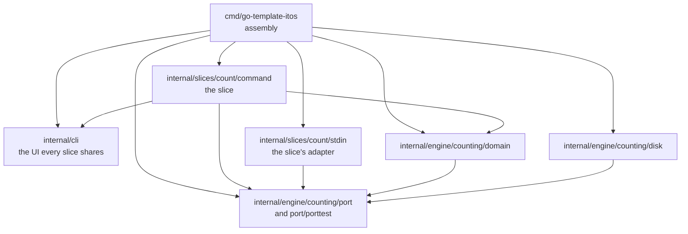

# 4. Solution strategy

Entry points stay thin over behavior the domain owns, reached through ports. Decision 11
(`docs/decisions/`) lays the code out as engines and slices; `docs/go.md` lists the packages.
Each command is a slice named for it, and what commands share is an engine that slices import,
never another slice.

An arrow is an import the rules allow. Every arrow not drawn is refused.

- **The domain owns behavior** and knows no UI, filesystem, JSON, flag or exit code.
- **A port is the domain's view of the outside**: an interface and its sealed failures, naming
  what went wrong without an OS's own errors. An adapter implements it and is the only code that
  touches the disk, standard input or a process.
- **A slice is a command.** Its `command` package holds the command line, the `Query` of domain
  values and the handler that calls the engine through its port. A second command is a new slice
  beside `count`, never an import of it.
- **`internal/cli` is the UI**. It imports nothing of the project's: it turns problems into
  an exit code and prints the plain or JSON answer (decision 13), so no domain carries a code.
- **`cmd/go-template-itos` assembles** every package: the context, the interrupts, the adapters.
  It is the one place that knows them all, and with `internal/cli` and a slice's `command`
  package the only importer of kong.
- **Default-deny rules hold each arrow.** `.golangci.yml` gives each package a role by its path
  and refuses Go code under `internal` that has none. `tools/bin/architecture-check` holds what
  import prefixes cannot say: an engine's domain imports no adapter, no slice imports another,
  only `cmd` imports a slice from outside the slices, and test support is never linked into the
  binary. Fixtures in `tools/testdata/architecture/cases.json` prove each rule refuses what it
  should.
