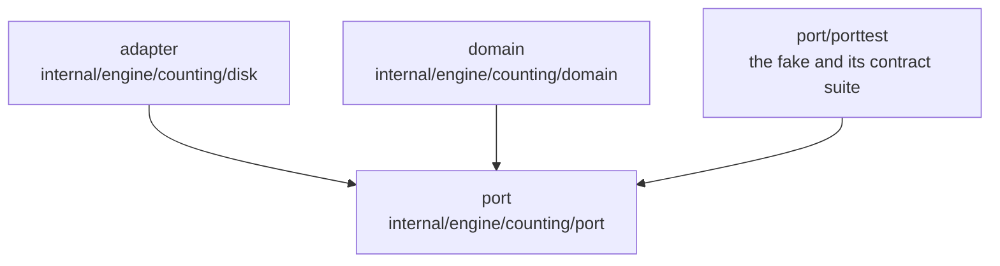

# 4. Solution strategy

Behavior lives in a domain, and everything outside reaches it through a port. Decision 11
(`docs/decisions/`) lays the code out as engines and slices; `docs/go.md` lists the packages.
This stack has engines only: the counting example is the one engine, and a command line, with
its slices, comes with the command-line feature.

An arrow is an import the rules allow. Every arrow not drawn is refused.

- **The domain owns behavior.** It knows no filesystem, JSON, flag or exit code, and imports
  only the standard library packages its rule lists and other engines.
- **A port is the domain's view of the outside.** An interface and its sealed failures, which
  say what went wrong without an operating system's own error types.
- **An adapter implements a port** and is the only code that touches the disk, the network or a
  process. It imports its engine's port, never the domain.
- **Our fakes stand in for ports in tests**, never mocks, and a contract suite holds the fake
  and every adapter to the same behavior (section 8).
- **Default-deny rules hold each arrow.** `.golangci.yml` gives each package a role by its
  path and refuses Go code under `internal` that has none. `tools/bin/architecture-check`
  holds what import prefixes cannot say: an engine's domain imports no adapter, no adapter
  imports another engine's adapter, and test support is never linked into a binary. Fixtures in
  `tools/testdata/architecture/cases.json` prove each rule refuses what it should.
